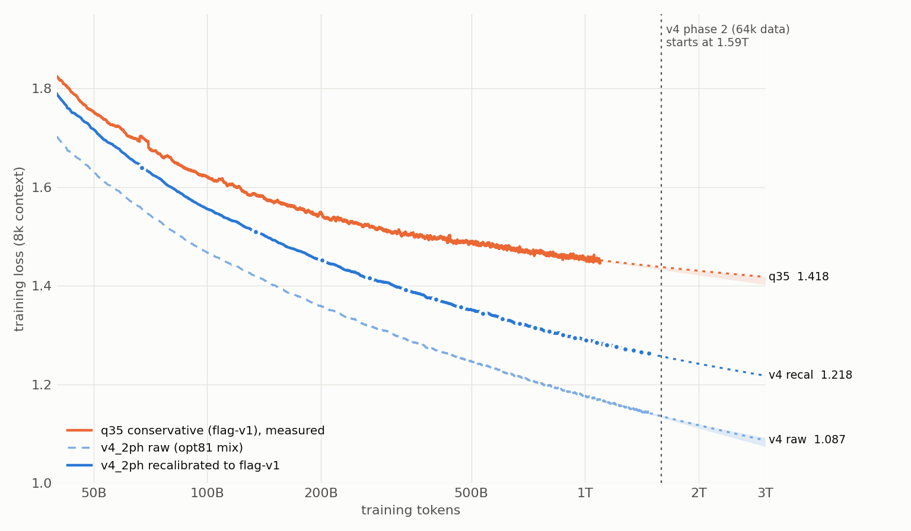

# Loss extrapolation: ambitious v4_2ph vs conservative q35 (2026-11-09)

Data: W&B `openeurollm-project/flag_hybrid`, runs `ambitious_v4_2ph_main` and
`conservative_q35_main_gqa` (ended at step 63,897 = 1.07T); v4 data to step 22,000 = 1.48T. Reproduce:

    python scripts/korbi/production/recalibrated_loss.py --out <dir>
    python scripts/korbi/campaign/loss_extrapolation.py --recal-dir <dir> --out docs/loss_extrapolation

**Recalibration** (`recalibrated_loss.py`): v4 trains on the opt81 v8ml mix (20.9 % reasoning), q35 on flag-decon-v1.
v4's losses on the fixed held-out sets (web_en, multilingual, code, math, reasoning, all) are re-weighted to flag-v1's
category shares, plus q35's own residual (training loss minus the same re-weighting of its fixed-set losses,
-0.051, stable from 67B to 1T tokens). The mix correction grows from +0.084 (67B) to +0.114 (1T), because v4
improves fastest on math and reasoning.

**Fits** (`loss_extrapolation.py`): tail only (>= 250B tokens; full-range fits flatten too early, see the q35
history), 200-step bins for v4, 800-step bins for q35. Out-of-sample check: fit 250-900B, predict 900B to the end
(`--oos-cut 900`).
Band = forms within 9 mnat out of sample; line = best of those by BIC.

## At equal tokens

| tokens | v4 raw | mix correction | v4 recalibrated | q35 | recal - q35 |
|---|---|---|---|---|---|
| 67B | 1.555 | +0.084 | 1.639 | 1.699 | -0.060 |
| 268B | 1.319 | +0.097 | 1.416 | 1.521 | -0.105 |
| 537B | 1.237 | +0.107 | 1.344 | 1.484 | -0.140 |
| 1.0T | 1.176 | +0.114 | 1.290 | 1.454 | -0.164 |
| 1.07T | 1.169 | +0.116 | 1.284 | 1.452 | -0.168 |
| 1.48T | 1.143 | +0.120 | 1.263 | 1.441 (q35 extrapolated) | -0.178 |

## Forecast (training loss)

| series | out-of-sample error | 1.59T (end of v4's 8k phase) | 3T |
|---|---|---|---|
| v4 raw | 0 to -1 mnat (E+PL) | 1.136 [1.133-1.137] | 1.087 [1.074-1.092] |
| v4 recalibrated | -1 to -2 mnat (E+PL a=0.3) | 1.257 | 1.218 [1.218-1.219] |
| q35 | 0 to +1 mnat (E+PL a=0.3) | 1.438 [1.432-1.438] | 1.418 [1.402-1.418] |

v4's raw slope has stayed at ~0.105 per e-fold of tokens since ~400B (q35's tail: ~0.045). Earlier forecasts held:
11-04 (from 403B) at 1T: train 1.18 predicted / 1.176 observed, every fixed set within 0.01; 11-07 (from 1.01T) at
1.48T: raw 1.1425 / 1.1432, recalibrated 1.262 / 1.263. Fixed set 'all' at 1.48T: 1.246 (11-07 range at 1.59T:
1.226-1.238, so it ends near the top of that range).

## Caveats

- v4 switches to its 64k phase (other data) at step 23,691 = 1.59T; beyond that the forecast is "if phase 1 continued".
- The recalibration assumes q35's -0.051 residual carries over to v4 (the first ambitious run, 16k context, gave -0.071).
- After the last evaluation the per-step mix correction is held flat.
- No loss jumps at the v4 restarts (256 nodes at 5909, spectral cap + z-loss at 9118, head dim 256 at 9815).
