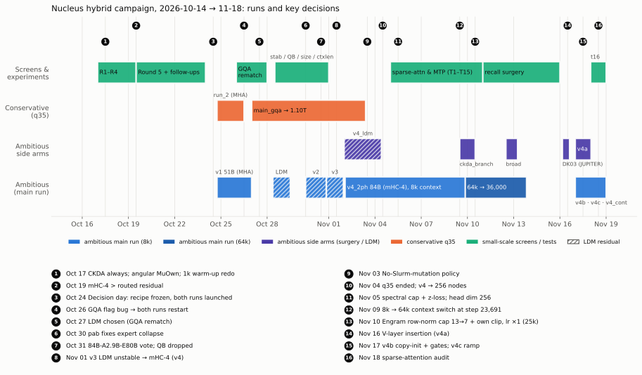
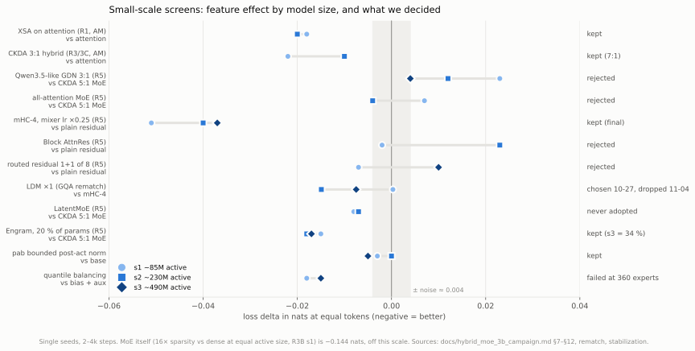
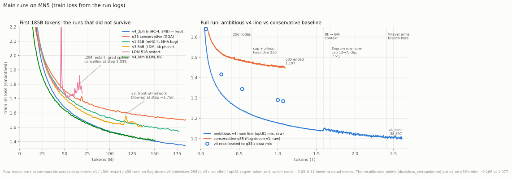
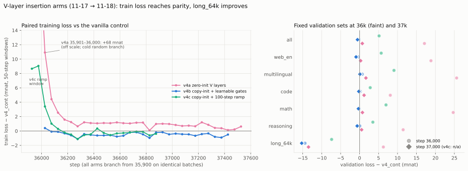

# Nucleus hybrid log: from small screens to ambitious v4b

**What this is.** A post-hoc, compressed record of the decisions behind the current main model,
**ambitious v4b**: an 84B-total / ~3B-active hybrid MoE with CKDA linear attention, an mHC-4 residual,
Engram n-gram memory, Muown, and six inserted shared-KV attention layers. It covers 2026-10-14 to
2026-11-18, mostly on MareNostrum 5 (MN5), with some work on JUPITER.

**How it was compiled (read-only).** Sources, cross-checked against each other:
- user messages and compaction recaps from 20 Claude Code sessions and 8 pi sessions;
- the git history: 1,988 superproject commits in Oct–Nov, plus the Megatron-LM and other submodule logs;
- the campaign and plan docs in `docs/`, and the ~150 auto-memory notes;
- read-only inspection of the run directories and logs on MN5 and JUPITER.

Detailed records stay in the source docs; this log points to them:
- [`hybrid_moe_3b_campaign.md`](hybrid_moe_3b_campaign.md): screens and main-run sections;
- [`ambitious_stabilization.md`](ambitious_stabilization.md);
- [`recall_surgery_ambitious.md`](recall_surgery_ambitious.md);
- [`campaign_3b_hybrid_midtraining.md`](campaign_3b_hybrid_midtraining.md);
- [`v4b_plan.md`](v4b_plan.md), [`v4c_plan.md`](v4c_plan.md), [`v4b_36000_crash.md`](v4b_36000_crash.md);
- [`pp_vs_fsdp.md`](pp_vs_fsdp.md), [`ep_fp8_speed.md`](ep_fp8_speed.md);
- [`flag_post_decontamination.md`](flag_post_decontamination.md), [`pool_allocation.md`](pool_allocation.md).

**Conventions.**
- Dates are 2026, written MM-DD. Loss deltas are in nats; negative is better.
- **(user)** marks a decision the user made or explicitly approved. Everything else was proposed by an
  agent and accepted.
- Screen sizes:

  | size | active params | total (MoE rounds) |
  |---|---|---|
  | s1 | ~85M | ~2.1B |
  | s2 | ~230M | ~5.7B |
  | s3 | ~490M | ~12B |

- Abbreviations: AM = angular MuOwn; QB = quantile balancing; pab = bounded post-activation norm;
  LDM = Linear Depth Memory residual.

---

## 1. Where we are (2026-11-18)

**Current model: ambitious v4b** (`recall_surgery/v4b_learned`, MN5 host008, 256 nodes). It continues
the v4_2ph main run from step 35,900.

| | |
|---|---|
| Body | hidden 2048. 48 mixer blocks, 7:1 with attention first (6 attention + 42 CKDA). Each block is followed by a MoE. Engram before blocks 1 and 24. **Plus 6 inserted "V" layers** (since v4a/b): shared-KV attention that reads K/V from the existing attention layers. 104 Megatron layers. |
| Attention | 16 q heads × **256** (widened from 128 at step 9,815), GQA with 2 KV heads, NoPE, qk-norm, XSA, output gate. KV cache 12 KiB/token in bf16; the V layers add none. |
| CKDA | 16 × 128, signed gates, shipped α init, bias-free β (β > 1 is load-bearing), low-rank output gate. |
| MoE | 360 routed experts × 768, top-5 + 1 shared. Sigmoid router in fp32. Expert bias 1e-3 + `global_aux_loss` 1e-4. pab inside SwiGLU, clamp 10. Routed-expert spectral cap (ramp 80 → 15). |
| Residual | mHC-4 (4 streams, log-space Sinkhorn), mixer lr ×0.25. |
| Engram | [2,3,4]-grams × 8 hash heads × 25,973,845 rows × 64 dims × 2 layers = 79.8B params. Sign hash, row-norm cap 7, own grad clip 1.0, lr ×1. |
| Size | **84B non-Engram total ("84B-A2.9B-E80B", ~164B with tables).** ~2.93B active for v4; +0.15B for the V layers. |
| Optimizer | `muown_classical`, constant lr 8.5e-4, no warm-up, no weight decay on Muown parameters. Embedding and router WD 0. Output z-loss 1e-5. |
| Data | option8_1 ("opt81"): v8ml, the 15T mix (80 % English v8 + 20 % multilingual flag), decontaminated, agent tokenizer (262,144 vocab). |
| Schedule | phase 1 at 8k (gbs 8192) to step 23,691 (~1.59T tokens); phase 2 at 64k (gbs 1024), 67M tokens/step. Configured to 236,733 steps (~15.9T). Decide after 10T. |
| Parallelism | Megatron-FSDP (ZeRO-3) + MoonEP EP4. FP8 expert-weight all-gather. 256 nodes ≈ 19.5–19.9 s/step at 64k. |

Live arms on the same 35,900 source, all on identical data order:

| arm | what it is | state 11-18 |
|---|---|---|
| **v4b** | copy-init V layers + two learnable zero-init gates (`g_v` on the attention write, `rho` on the residual mixing) | step 37,467 (host008, 256n). Passed the 36,000 crash after the fix. Validation "all" 1.2045 at 37k; long_64k −0.015 vs control at 36k and 37k. |
| v4c | same copy-init, branch brought in by a deterministic 100-step ramp | step 36,920 (host007, 256n) |
| v4_cont | vanilla v4 control, the line carrying normal training | step 38,897 ≈ 2.61T tokens (host006, 128n, ends 11-19). Train 1.102, val-all 1.2041 at 38k |
| v4a | zero-init V layers | **inert**: zero `o_proj` gets no gradient under Muown. Preempted 11-18 01:29 at 37,563 for v4c. |

On recall evals all arms read parity within ~1–2 pp of noise. The paired SQuAD v2 deltas flip sign
between checkpoints.

**User plan (11-18):** keep the attention insertion for its long-context gain, keep everything
running, and continue only the best of v4 / v4b / v4c after the matched 38,000 evals.

**Next:** attention sparsification (§4.12).
- The parameter-free page selection `page_mean_pg` is the default.
- An 11-18 audit found a concrete flaw in each of our NSA, CSA2 and LSA implementations. The fixed
  Phase B re-ranking (t16) is queued.
- A method replaces `page_mean_pg` only if it beats it by more than 0.01 nats.

---

## 2. Timeline at a glance

| phase | dates | one line |
|---|---|---|
| 0 Pre-history | 2025-10 → 2026-10-13 | autoexp tooling; Qwen3 MoE speed work; 32B dense flagship (JUPITER); mHC / AttnRes / nGPT residual sweep; ComplexKDA release + scaling ladder |
| A Build-out | 10-14 → 10-16 | hybrid stack in Megatron 0.19 (L/C/N symbols, Engram, PKM, XSA, MLA, routed residual …); move to MN5 ehpc533; speed suites |
| B Rounds 1–4 | 10-17 → 10-19 | Megatron over torchtitan; round 1 invalidated (warm-up); AM optimizer; CKDA always; MoE shape; mHC-4 wins residuals |
| C Round 5 → decision day | 10-19 → 10-24 | s1/s2/s3 grid; LDM, KronLSTM, IAT, SSMax tried; classical Muown; 7:1 attention-first; FSDP + MoonEP; recipe frozen; both main runs launched |
| D GQA restart, pools, LDM | 10-25 → 10-29 | silent MHA bug; sub-Slurm pools; LDM chosen after the rematch; expert collapse |
| E Size vote, v2, v3 | 10-30 → 11-01 | pab; 84B-A2.9B-E80B; QB fails at scale; bias + global aux; 4k/16k/64k curriculum; v3 (LDM) unstable |
| F v4_2ph main run | 11-02 → 11-08 | mHC-4, 8k → 64k; 256 nodes; spectral cap + z-loss; head dim 256; inference / eval stack |
| G Hardening, recall gap | 11-09 → 11-13 | per-layer diagnostics; **8k → 64k switch at 23,691**; **Engram row-norm cap + clip + lr ×1 at 25k**; sparse-attention T-series; CKDA-branch and recall surgeries |
| H Testbeds, V layers | 11-14 → 11-18 | JUPITER testbeds; 84B on JUPITER; main run stops at 36,000; v4a → v4b / v4c; sparse audit |

---

## 3. Pre-history (2025-10 → 2026-10-13)

- **2025-10 → 2026-02.** `oellm-autoexp` built: Hydra sweeps, SLURM submission, monitor and restart
  actions, multi-cluster support (JUPITER, LEONARDO, LUMI, MN5), cooldown chaining.
- **2026-03 → 06.** Qwen3-30B-A3B / 235B MoE speed comparisons (Megatron vs torchtitan, DeepEP) and the
  9B "baby" run on LEONARDO.
- **2026-07 → 08.** First hybrid comparison runs (07-29) and the residual-architecture sweep:
  - fused mHC went from 94.9 to 195.8 TFLOP/s and gave +0.055 at matched tokens;
  - no residual scheme moved the speed Pareto frontier.

  Also: the oellm 32B dense flagship on JUPITER, and the port to Megatron 0.19.
- **2026-09.** ComplexKDA (CKDA) released in the FLA fork (09-21), then the CKDA Megatron scaling
  ladder (09-28): 180 cells, 47M–1.7B × 6–50B tokens.
  - Offsets vs attention: CKDA −0.059, CKDA 3:1 hybrid −0.071 nats; hybrid vs pure ≈ −0.019, constant
    in scale.
  - Fit exponents: α 0.52 vs 0.40 for attention.
  - HP law: η* ∝ N^−0.417.

  This is the prior the campaign started from.

---

## 4. Phase log

### 4.1 Build-out (10-14 → 10-16)

- 10-14/15 **(user)**: build a broad ablation platform on Megatron `oellm/v0.19-hybrid` +
  autoexp `feat/hybrid-v0.19`:
  - all mixers (attention, GDN, mLSTM, KDA / CKDA, Mamba, short conv);
  - optimizers (AdamW, Muon, Muown, angular MuOwn);
  - residuals (mHC, AttnRes, nGPT, looped);
  - Engram, PKM, Canon, XSA, MLA, routed residual streams, LatentMoE, PLE, SWA, triadic and power
    attention, each with kernels and tests.

  No MTP in pre-training (user, "DeepSeek 4.1 also doesn't use MTP in pre-training").
- 10-15 **(user)**: move to MN5 account **ehpc533**, because the old ehpc390 scratch was full
  (4.20 / 4.00 TB). Code rules:
  - edit locally, mirror with `sync_to_marenostrum.sh` and a `SYNC_STAMP`;
  - every run goes through autoexp + monitor;
  - all CuTe / TileLang kernels live in the new `cute_kernels` submodule.
- 10-16: speed suite. Optimized 130M dense reference: 310–329 TFLOP/s (plain Megatron: 186).
  - **(user)** goal: every feature at ≥ 0.7× dense throughput.
  - Below that bar: power 0.40, triadic 0.42–0.46, mHC-4 0.54–0.58, KDA / CKDA ~0.66, Mamba2 0.59
    (user: "keep Mamba2 off").
  - MoE reference: 120M active / 1.2B total.

### 4.2 Framework, round 1, the redo (10-17)

- **Megatron over torchtitan.**
  - 130M: 320–344k vs 271–320k tok/s/GPU.
  - A3B-30B: ~6.6k vs ~3.6k tok/s/GPU (titan at 0.55×).
  - **(user)**: tok/s/GPU, not TFLOP/s, is the speed metric.
- **(user) goal**: speed-test a 3B-active model at 30–100B total, then pick the best ~3B-active hybrid
  MoE for ~10T tokens. Decisions made at small scale for **< 10k GPU-h** (round 1: 2k).
  - Feature gate: beat the parameter-matched base by > 2σ at equal lr / bs, at ≥ 0.7× speed.
  - Later sharpened: win at **two sizes** by > ~0.006.
- Round 1 (AdamW, s1/s2, datamix4): every feature beat attention. KDA + XSA −0.064, attention + XSA
  −0.051, GDN −0.032, CKDA −0.032.
- **(user) "38 steps warm-up is way too little."** Round 1 was declared invalid and redone with a 1k
  warm-up, stable phase only, comparisons at equal tokens, and per-run fits
  L = E + A(τ + t0)^−α. The stable-phase ranking matched the cooled ranking (Spearman 0.98–1.00).
- **AM beats AdamW by 0.10–0.12 nats** at each optimizer's best warm-up (AM wants none). Under AM the
  hybrid gains halve, and two features fail the gate:
  - GDN (+0.013 / +0.006);
  - the plain-attention output gate.
- **(user) "CKDA always", standard init.** The screen's CKDA had a spread α init and a linear gate;
  that is why KDA looked better. KDA vs CKDA is never offered as a choice again.
- **(user)** recipe for round 3:
  - all hybrids NoPE; attention gets qk-norm + XSA + output gate;
  - "fewer heads, head dim 128 everywhere". This is the origin of the production 16 × 128 attention.
    It was a fairness and kernel choice and was never screened.

### 4.3 Rounds 3 / 3B / 3C / 4 (10-17 → 10-19)

- **Round 3** (s1, 2.1B tokens, vs attention):

  | arm | AM delta | note |
  |---|---:|---|
  | CKDA 3:1 hybrid | −0.022 | |
  | CKDA 5:1 hybrid | −0.017 | |
  | mHC-4 | −0.059 | −23 % speed |
  | Engram (unmatched) | −0.070 | |
  | Qwen3.5-like GDN | +0.005 | |
  | nGPT | +0.24 | |

  **(user)**:
  - 5:1 is acceptable;
  - drop XSA inside CKDA;
  - nGPT gets its own lr sweep. It still ended 0.13 behind AdamW and diverged at 2× lr, so it was
    dropped.
- **Round 3B, MoE shape** (32 runs). At equal active size MoE gives −0.144 at 16×, with diminishing
  returns: 32× −0.157, 64× only −0.008 more.
  - Finer experts are slightly better.
  - Shared expert: yes.
  - **Sigmoid router + expert bias + aux 1e-4** is best (max_vio 0.6).
- **Round 3C.** Under AM the residual mixers ran ~4× too hot. `residual_mixer_lr_mult 0.25` recovers
  mHC-4 to −0.048.
- 10-18 **(user) production target**:
  - **beat Qwen3.5-35B-A3B on inference cost and quality at Q4** (24–32 GB GPUs, DGX Spark);
  - ~600k (up to 1M) GPU-h;
  - kernels written in-house.

  The sizing doc recommended 39B-A2.7B (160 × 768, top-5 + 1) over 80B-A3B: it fits 24 GB at Q4, and
  64× sparsity gains only 0.008.
- 10-18: a "political" Qwen3.5-arch baseline runs in parallel ("conservative").
- **fp8 rejected** (10-18): −5 to −8 % at A3B, because quantize overhead exceeds the GEMM gain at
  expert width 512–768. bf16.
- **Round 4 / 4R** (s1, step 4000, vs `h5_moe`):

  | arm | delta |
  |---|---:|
  | mHC-4 | **−0.049** (after the log-space Sinkhorn NaN fix) |
  | routed 3-of-8 keyed + mixing | −0.030 |
  | mHC-2 | −0.025 |
  | LatentMoE | −0.021 |
  | routed 1+1-of-8 | −0.004 |

  The user had preferred the routed residual for its novelty. 10-19 **(user) "so mHC is a go-to
  here"**: routed residual called off.
- 10-18/19 **(user)**: pre-training at 8k, then 16k, with document masking. BOS at every document
  start; `eod_mask_loss` off.

### 4.4 Round 5 and follow-ups (10-19 → 10-24)

Round 5 protocol: flag mix, 8k, document masking, AM without warm-up, s1/s2/s3, equal active and total
MoE parameters, 4000 steps. See [screen deltas](#6-screen-results-in-one-figure).

- **mHC-4 ×0.25**: −0.051 / −0.040 / −0.037 (s1/s2/s3), shrinking ~N^−0.18.
- **Qwen3.5-like GDN 3:1**: +0.023 / +0.012 / +0.004, i.e. CKDA leads at every size. The lead narrows
  with size and grows with tokens.
- **LDM** (Linear Depth Memory, our institute's paper; user asked for it 10-19): ×2 lr −0.068 vs
  plain, ahead of mHC-4 at s1/s2.
  - But it had the **worst retrieval from 8k up**: 64-fact at 32k, 0.24 vs 0.76.
  - Speed: 81 % of mHC-4 under FSDP.
- **Engram**: replacing experts at equal total parameters gives −0.012 to −0.018. The gain shrinks with
  tokens.
  - 10-20 **(user)** "go for Engram as it's such a clear improvement".
  - 10-22: Engram at 30 % of parameters.
- **KronLSTM / CKLSTM**:
  - loss ≈ CKDA (+0.004 at s2/s3);
  - 64k long-document NLL +0.42;
  - 64-fact retrieval at 64k 0.04 vs 0.30.

  10-23 **(user) "CKDA it is."**
- **IAT** (internal attention, user-requested, parameter-matched by cutting whole experts): +0.010 to
  +0.084 behind mHC-4 and slower. **(user) "stay with mHC-4, DeepSeek did a good job there."**
- **SSMax**: dropped by the user, because the qk-norm gain already provides a temperature. log-n
  scaling is used at eval only.
- Cooled s3 downstream: CKDA + mHC-4 mean 50.3 vs Qwen-like 48.4. Multi-key retrieval at 32k: **0.84**
  vs 0.24 for plain CKDA. 4-bit RTN costs every architecture the same (+0.004–0.006).
- **7:1 vs 5:1** (s2 + mHC-4): +0.003 loss, but **better on every long-context metric** (64-fact at
  64k: 0.62 vs 0.12).
  - **(user)**: 7:1, NSA-style sparsification later on top.
  - 10-23 **(user)**: block 0 is always attention ("attention first"; neutral in loss).
- **Optimizer.**
  - The user found a hidden 1/(1 + 0.001t) direction-lr decay in angular MuOwn and called it "crazy"
    for 10T.
  - A long-horizon tiny study (100k steps) showed **classical Muown −0.075 vs AM p = 1**, AdamW
    +0.094. Crossover ~18–20k steps.
  - 10-24 **(user) "No weight decay, classical Muown it is."**
- **Parallelism** (10-23/24): PP4×VPP2 carries the 4× / 8.5× wide residual stream in its p2p traffic.
  Megatron-FSDP ZeRO-3 + MoonEP + double buffering reached **7,537 vs 6,151 tok/s/GPU** at 8 nodes.
  The EP agent built per-matrix-owner Muown for FSDP.
- **EP backends**:
  - HybridEP is the best vendor library in-node;
  - DeepEP / HybridEP internode are impossible on MN5 (4 GPUs per node, no NVSwitch, no IBGDA);
  - the in-house **MoonEP** reached 195–236 TFLOP/s on Qwen3-30B-A3B.
  - Manual GC + no mmap: +16 % tok/s on the document-masked hybrid.
- **Data.** 10-22: the flag data contained verbatim GSM8K / MATH500. Decontamination by whole-document
  drop against all benchmarks, with a 70 % verbatim-run rule (user) → **flag-decon-v1** (0.133 % of
  13.5T tokens dropped), the production default from 10-24.

### 4.5 Decision day and launch (10-24 → 10-25)

**(user) "full go"**: the recipe frozen on 10-24.

| axis | decision | why |
|---|---|---|
| mixer / ratio | CKDA, 7:1, attention first | long context at 7:1; CKLSTM / GDN / KDA rejected |
| residual | mHC-4, mixer lr ×0.25 | LDM rejected for retrieval and speed (reversed 10-27, see §5.1) |
| optimizer | `muown_classical`, no WD, constant lr **8.5e-4** (η ∝ N^−0.417 law, no sweep), no warm-up | long-horizon study |
| details | untied embedding / head, head-wise QKV Muon (−0.005), SwiGLU clamp 10, fp32 router, Engram lr ×5 (DS-V4.1) | screens / DS-V4.1 |
| batch / context | gbs 64M tokens (4096 × 16k), document masking, BOS | batch law; 49 % of flag tokens in documents > 8k |
| MoE | sigmoid + bias + aux 1e-4 | round 3B |
| data | flag-decon-v1 | decontamination |
| systems | FSDP + MoonEP EP4, async checkpoints | 7.5k tok/s/GPU at 8n |

Launched the same day:
- **ambitious v1** = 51B-A2.9B-E40B (216 experts, Engram 40B), 32 → 128 nodes, ~5,000 tok/s/GPU;
- **conservative q35** = the colleague's Qwen3.5-35B-A3B replica (GDN 3:1, 256 × 512 top-8, AdamW 1e-3,
  2048 × 8k). On HSDP it ran at 6,430 tok/s/GPU on 32 nodes, then ~4,100 on 128 nodes.

Before the launch, the colleague's original q35 run had died at its first save: MoonEP replica ids came
from the dense DP rank. The fix (44a703806) would otherwise have killed ambitious too.

Campaign budget for the decisions: 2k → 3k → 5k → 7k → 7.5k → 8k → 9k GPU-h. ~8.4k had been used by
10-24. The cap reached 10k on 11-09 with the fp16 screen.

### 4.6 GQA bug, pools, the LDM flip (10-25 → 10-29)

- 10-25: equal-token eval marks (ambitious 500·2^n = conservative 2000·2^n), hard-linked into
  `ckpt_eval`.
- **10-26: the silent GQA bug**, found during the HF export. `num_query_groups` is ignored without
  `group_query_attention: true`, so both main runs and every campaign screen had trained MHA. For q35
  that meant 8× the KV cache and +6.7 % active parameters.
  - **(user) "major problem, we'll have to restart it all."** Both runs restarted fresh with GQA.
  - Ambitious v1 ran to ~2.6k steps (~176B tokens) before being cancelled.
  - The q35 run_2 MHA run (10.1k steps) is kept as a reference.
- 10-26/27: **sub-Slurm-job pools**. Multi-day host allocations run many runs; queued cns144 jobs are
  adopted; `pool_ctl` handles singleton, preempt and packing.
  - One degraded NIC (as02r4b16) had halved 128-node speed. Only `fsdp_comm_bench` found it.
- **10-27: GQA rematch** (final recipe, classical Muown). LDM ×1 vs mHC-4: s1 +0.0003, s2 −0.0149,
  s3 −0.0075.
  - LDM has the best long-document NLL.
  - The retrieval deficit disappears with GQA.
  - Authors' CuTe-under-recompute path: 92 % of mHC-4 speed.
  - **(user) "LDM is the residual."**
- 10-28: **ambitious restarted on LDM** (`main_ldm`, 64 nodes, 5,450 tok/s/GPU).
  - Grad spikes from ~600 (max 22k); cancelled at 1,038.
  - Normalized / nGPT streams on LDM: +0.145 or divergence. Rejected.
- 10-28 **(user)**:
  - ambitious configured for 12T (~630k GPU-h); train past 10T, then decide;
  - q35 may stop at ~1T;
  - no late node-count switches (the cyclic sampler repartitions data). The reference-layout sampler
    lifted this rule on 11-01.
- 10-29: **flag-decon-v2** (v6 references, 0.234 % dropped) + **agent tokenizer** (59 chat / agent /
  FIM delimiters in unused slots) = default data (user). A comparison with OpenEuroLLM's "-pure" sets:
  theirs drop 7–15× more documents, with little overlap.

### 4.7 Stability, the size vote, v2 and v3 (10-28 → 11-01)

- **Expert runaway diagnosed (10-29/30): single-expert spectral collapse.**
  - One expert per deep layer: stable rank 200–300 → single digits, gain ~10× the median.
  - Frobenius and row norms stay flat, so norm caps cannot see it.
  - Step-driven: Muown without WD rotates ~1/√t.
  - Fix: **pab** (h ← h / max(rms(h), 1) inside SwiGLU): s3 −0.005, −0.1 % speed. **(user)** into
    production 10-30.
  - Spectral cap κ 2/3/5, stable-rank floors, peri-LN, v / g WD and clamp 5 lost or faded.
- **QB** (quantile balancing): −0.013 to −0.018 at s1/s3. 10-29 **(user) "we should really use QB
  alone"**. EMA 0 blew up in the reproducer, so EMA 0.9 + pab.
- **Size.**
  - 64-node sweep: step ≈ 33 s + 0.081 s × experts; 288 experts is the uncapped limit.
  - NCCL / MoonEP hold ~11.5 GiB outside PyTorch, hence `per_process_memory_fraction 0.80`.
  - **(user) maximize size at ≥ 4,500 tok/s/GPU**: experts can be offloaded at inference, and Engram is
    cheap at batch 1 (host RAM / NVMe).
  - 10-30/31 vote → **e360 + Engram 80B ([2,3,4] + sign hash, never screened) = 84B-A2.9B-E80B**, cap
    0.80, 8 NCCL channels: 4,535 tok/s/GPU at 128 nodes.
- **FP8 expert-weight all-gather** (E4M3 1×128): +5.4 % speed, +0.005 loss (≈ a one-step delay).
  Adopted (user): "somewhat QAT; inference is FP8 anyway". fp8 GEMMs stay rejected (0.82× bf16).
- **v2 starts (10-31), all killed within hundreds of steps:**
  - QB at 360 experts × 128 nodes: max_vio 35, 1,811 near-dead and 788 ghost slots;
  - plain `aux_loss` at mbs 1 × 64k turned out to be per-sequence balancing, forbidden by the batch-1
    inference target (user);
  - `global_aux_loss` was 1/DP too weak (Megatron 24a814eba).

  **(user)**: QB dropped. Balancing = **expert bias 1e-3 + fixed global aux 1e-4**, never per-sequence.
- **ambresid** (16 nodes, ~300 steps): mHC-4 led LDM by 0.019–0.031. **(user) "LDM one final time in
  v3, else mHC-4."**
- **Context from scratch** (`ctxlen4n_s3`): short context learns faster; a 4k start beats
  64k-from-scratch by 0.04 at 64k. **(user)** curriculum **4k → 16k → 64k (2 / 8 / 90 %)**, 2^26 tokens
  per step.
- **Data v8ml** (10-31): 80 % OpenEuroLLM v8 English (12T, decontaminated, 1.73 % dropped) + 20 % flag
  multilingual, split by document into frozen curriculum stages. Seven fixed held-out validation sets
  from 11-01: all, web_en, multilingual, code, math, reasoning, long_64k.
- **v3** (10-31 20:25): 84B-A2.9B-E80B, LDM width 128, pab, bias + fixed global aux, CKDA β on Adam.
  - Phase 1 at 28.6 s/step.
  - **11-01: destabilized**: grad norm 0.22 → spikes of 190 at 1,730, loss 1.51 → 1.59, front MoE
    routers collapsed, front LDM write ratio 1.3 → 8.2.
  - **(user) "we should go with mHC-4 now."**

### 4.8 The v4 / v4_2ph main run (11-01 → 11-13)

- 11-01 23:35: **v4** = the v3 recipe with mHC-4 (27.1 s/step), plus `v4_ldm` (embedding RMSNorm) as
  a last LDM try.
- 11-02: replaced by **v4_2ph** (user, prompted by an external request):
  - 8k (gbs 8192) → 64k (gbs 1024) at step 23,691, restarted from scratch;
  - **option8_1** data mix;
  - embedding / router WD set to 0 (user).

  Packed checkpoint scalars cut 128-node save / load from 10 min / 43 min to 90 s / 13 min.
- 11-03 **(user) policy**: never reschedule, update, requeue or cancel Slurm jobs without permission
  (priority). Recorded in `AGENTS.md`.
- 11-04: **v4_ldm stopped for good at 2,244** (user: "indeed broken"). LDM led by 24 mnat at step 500
  but fell behind by step 2,200. **mHC-4 is final.**
- 11-04: **q35 ended for good** (user). Its last segment trained to 65,266 (~1.10T tokens) on 11-03
  and failed on a network error. The notes cite 63,897; see §7.
- 11-04: watchdogs removed except critical ones, none on cns144 (user). Watchdog auto-cancels had
  released held hosts and drained priority.

v4_2ph lineage by step:

| step | date | change |
|---:|---|---|
| 0 | 11-02 | 8k phase, 128 nodes (p129) |
| 5,909 | 11-04 | **128 → 256 nodes** via `pool_ctl`, same data order (reference-layout sampler): 14.65 s/step, 4,474 tok/s/GPU |
| 6,000 | 11-04 | save-after-validation host OOM (persistent validation workers, +120 GB/node) → fixed |
| 9,118 / 9,789 | 11-05 | **routed-expert spectral cap ramp 80 → 15 + output z-loss 1e-5** (one runaway expert per deep layer, fc2 σ 43–47× init; deep stream RMS 2 → 7.5) |
| 9,815 | 11-05 | **attention head dim 128 → 256**, function-preserving widening (loss 1.220 vs 1.221, +1 % step time) |
| 12,360 | 11-06 | k re-seed: new q/k channels were stuck (bilinear, no first-order gradient) |
| 14,900 | 11-07 | ~1T tokens (train 1.176, matching the 11-04 forecast of 1.18) |
| 18,578 | 11-08 | 256 nodes on p264. A flapping IB port (as07r2b24) had slowed steps to 15.75 + spikes; excluded → 14.9 s |
| 22,304 | 11-09 | restart for per-layer grad-norm diagnostics. Spikes come from layer-0 attention and the Engram tables (~60 % of spike norm²) |
| 23,691 | 11-09 | **8k → 64k context switch** (phase 2: gbs 8192 × 8k → 1024 × 64k, same 67M tokens/step, opt81 stage-2 data). 17.2 s/step (−13 %): attention straggler on long documents, one sequence per rank. Train loss +0.013 at first (1.138 → 1.151) |
| 25,000 | 11-10 | **Engram row-norm cap 13 → 7** + own Engram grad clip 1.0 + Engram lr ×5 → ×1 (user, "all in one go at 25k"); details below |
| 32,105 / 32,462 | 11-11 | GPU faults, automatic retries from rolling saves |
| 35,900 / 36,000 | 11-13 | host OOM at the persistent save (~70 GB/rank) killed nodes; the pool marked all nodes dead. **Main run stopped**; continued only through the V-layer arms from the 35,900 save |

**The 8k → 64k switch (step 23,691, 11-09 ~21:00).**
- Planned since 11-02. The phase-1 document set holds exactly 1.59T tokens (23,691 steps).
- On 11-09 the user considered postponing the switch to 2T (step ~29,800) for "one clear second phase".
  Moving it would have repeated ~26 % of the stage-1 documents or needed a re-split, so the user kept
  23,691: "maybe we should just keep going".
- The two interventions were deliberately separated: the user put the Engram restart at 25k, not 24k,
  "so we can distinguish the effect of the ctx extension and the stabilization".
- Validation long_64k improved from 1.363 at 20k to 1.295 at 24k and 1.247 at 35k.
- The −13 % throughput comes from one 64k sequence per rank, so the longest document sets the step time.
  Only sparse or linear attention fixes that (§4.12).

**The Engram row-norm cap (step 25,000, 11-10).**
- **Why.** The 11-09 diagnostics showed the Engram tables carrying ~60 % of the gradient-spike norm² and
  leading most spikes at the end of phase 1.
  - Nothing normalizes between the Engram output and the residual stream or the LM head, so a few heavy
    rows feed in directly. At checkpoint 24,000: mean row norm 4.37, p99.999 7.03, max 9.5 / 12.8.
  - Engram lr ×5 had been copied from DS-V4.1, where it scales a Sinkhorn-balanced update. Our Adam took
    5–18× larger steps than intended.
- **What (user, 11-09/10, "all Engram fixes in one go at 25k").** The restart happened exactly at
  25,000; it was queued at 04:19 and started at 10:16 on host004.
  - Per-row L2 norm cap ramped from 13 to 7 over 1000 steps (≈ the p99.999 of the checkpoint;
    DS-V4.1-like magnitudes). Megatron `7c67b1193`.
  - Separate Engram gradient clip 1.0 (`--engram-clip-grad`, `d2081946c`), so table spikes no longer
    clip the dense model's update.
  - `engram_lr_mult` 5 → 1.
  - A Sinkhorn ×5 table optimizer (DS-V4.1 style) was screened at s3 (+1.9 to +2.7 mnat vs Adam) and not
    deployed. An untested Adam → Sinkhorn resume was the other reason.
  - From 11-10 on, continuations use `p2cont` (latest checkpoint).
- **Effect.**
  - A transient at 25,006–25,036: grad norm up to 20.8, loss +0.003 at peak, +0.0009 on average.
  - Train loss 1.141 (24.9–25.0k) → 1.138 (25.0–25.1k).
  - By 26.1k the cap touches only ~10.3k of 1.247B rows per step (0.0008 %); max pre-cap norm 7.003.
  - Grad-norm spikes > 1 became more frequent (2.8 % → ~5–7 % of steps), but smaller. The Engram-led
    share fell from 69 % to 49 %, and the own clip isolates them from the dense update.
  - The user still saw heavy spiking at 26k (11-10). The later spikes come from layer-0 attention, and
    the QK-norm gains already bound logits at ~20.
  - Open from this thread: a loss penalty on capped rows (a real downward gradient), the Sinkhorn
    optimizer, and converting the first MoE layer to dense.

**Ambitious vs conservative, loss.** v4 losses are recalibrated to q35's flag mix: opt81 trains
~0.09–0.11 nats lower at equal tokens.

| tokens | v4 (recalibrated) | q35 | gap |
|---|---:|---:|---:|
| 67B | 1.639 | 1.699 | −0.060 |
| 537B | 1.344 | 1.484 | −0.140 |
| 1.07T | 1.284 | 1.452 | **−0.168** |

- Raw tail slope: v4 0.105 vs q35 0.045 nats per e-fold of tokens.
- On the fixed validation set "all", v4 reached q35's 1T level after ~2.65k steps (~180B tokens).
- The 10-29 q35 "plateau at 1.473" fit was falsified on 10-30. Fit only the tail.

### 4.9 Inference and evaluation stack (11-01 → 11-09)

- **HF / vLLM exports** match Megatron to 3e-5 – 7e-5.
  - vLLM fork `oellm/main` (v0.32) carries the `oellm_ambitious` and `oellm_q35` ports.
  - A Triton current-device bug in the FLA fork caused silent NaNs in multi-GPU HF; fixed.
- **Fast decode** (exp 012): **100 tok/s per request at batch 1 per GPU** (was 20), via full decode
  CUDA graphs, UVA Engram tables, fused kernels and FP8 w8a16 experts.
  - HF prefill fast path: 22–34k tok/s.
  - vLLM engine start 1298 s → 209 s.
- **FLAG eval suite**:
  - 438 rows in grouped one-load runs, with queue workers;
  - typed launcher (`scripts/evals`);
  - oellm-eval node-local runner on MN5 pools and JUPITER (11-09).
- **Eval-context bug**: every ambitious vLLM eval before 11-06 16:50 ran at `max_model_len` 2048 (the
  export had no `max_position_embeddings`), while q35 used 8192. Fixed with a 64k–100M limit (NoPE).
- **Winogrande closer-mention bias**: every ambitious checkpoint picks the nearer entity 66–74 % of the
  time (gold 49 %); q35 and the 32B sit at ~50 %. It reproduces in Megatron itself, so it is a model
  property. The 0-shot gap mostly vanishes at 5-shot (72.2 vs q35 73.1).
- Aggregate FLAG score (normalized): ambitious 13k–15k ≈ 0.45 vs 32B@300k 0.498.
  - Ambitious is ahead on knowledge, MMLU, multilingual and math, and +18 pp on IFEval.
  - It is behind on reading comprehension and coreference.

### 4.10 The recall gap and surgeries (11-09 → 11-16)

**Gap at 35,603 vs our 32B dense:** CoQA F1 −15.3, SQuAD v2 F1 −13.2, Winogrande −3.6.

- Contamination explains none of the SQuAD / Winogrande / WSC gap and 10–18 % of the CoQA gap
  (contamination split, 11-10).
- **CKDA branch post-fit** (11-09/10, from 23,300; budget 6k → ~8.4k GPU-h): attention, KronLSTM or
  kvshare replacing CKDA at layers 9/25/41, with crossfade and calibration. No arm beat the `drop`
  control by more than ±1.5 pp.
- 11-10/11 **(user) /goal**: find an architecture intervention worth +8 pp on SQuAD / CoQA /
  Winogrande. Constraints:
  - "brain surgery", not a retrain;
  - keep the early complex-eigenvalue CKDA layers;
  - Engram stays (user 11-11 / 11-15).
- **Inference knobs** at 23,500:
  - Engram ×0 → Winogrande +4, Belebele −30;
  - capping CKDA β at 1 → −10 on everything. **β > 1 is load-bearing; CKDA is not the culprit.**
- **Broad session** (11-12/13; kv8, kv16, post4, cgqa arms from 23,300): decision rule not met.
  Plain phase-2 training itself gave +3.5 CoQA.
- **Diagnosis** (11-14):
  - SQuAD v2 is ~⅔ over-abstention (21–24 % vs 4–7 % for the Qwens) and ~⅓ precision.
  - SWDE / FDA copying is at Qwen level.
  - A 1.7B fine-tuning probe closes the hybrid's SQuAD deficit with a general SFT mix.
  - User correction (11-14): the CoQA / SQuAD gap to our **own** 32B is substantial and flat over
    1.9T tokens. It was not dismissed as post-training behaviour.
- **a31** (11-13): 3:1 surgery from step 1000 with random attention layers. Inconclusive; queued.
- **JUPITER small31 testbed** (0.5B, 20B tokens, 11-14/15):
  - 3:1 from scratch beats 7:1 by +5–7 CoQA. But q35c (3:1, same data) at 1T is **not** better than
    ambitious, so the ratio does not explain it at scale.
  - Stitching arms: K (additive kvshare) −0.0071 val, +2 FDA; D2, DK2, W, T.
  - No arm passed the +2 pp gate.
- 11-15/16: **84B brought up on JUPITER** (checkpoints and data byte-identical; step 35,901 Δ 1e-6).
  - DK03 (K + rest dropout 0.3) on 256 nodes reached 35,999.
  - It crashed at the 36,000 validation (`misaligned address`), then stale GPU processes and an async
    save with no metadata followed.
  - **(user)** cancelled JUPITER and moved back to MN5.

### 4.11 V-layer insertion: v4a → v4b → v4c (11-16 → 11-18)

- 11-16 22:32 **(user)**: drop the parallel K branch, which was unconventional and hard to integrate.
  Instead, **insert shared-KV attention as first-class "V" hybrid layers** (v4a), at 9/25/41/58/74/90,
  reading K/V from attention 0/18/35/53/70/87.
  - Effective attention share goes from 12.5 % to 22 %; no extra KV cache.
  - **(user)**: it must be a real open-ended continuation, not a test.
- Surgery bugs found along the way:
  - missing mHC mixer keys;
  - a rename chain that lost 118,650 keys;
  - doubled optimizer FQNs;
  - `num_layers` 98 → 104;
  - **Engram hash seeds derive from `layer_number`**: the insertion re-seeded the second Engram layer
    (+0.16 loss), fixed by pinning;
  - V layers had no input norm.

  V6 verified 1:1: +152,188,578 params.
- **v4a was inert.** Under Muown a zero-init `o_proj` has zero row magnitude and zero direction, so it
  gets no update. Readouts at 35.9k–36.9k: parity. RULER: a niah_multiquery regression (−41 pp at 4k).
- 11-17 **(user)**: wrap the whole block in a gate, with tests showing no change when unconfigured.
  - **v4b** (`v4b_learned`, host008): copy-init (q / gate / o / q-norm copied from the source
    attention) + two learnable zero-init gates. Step 35,901 = control exactly (1.102696 vs 1.102695).
    The gates open only at Adam's scalar step size (`g_v` 0.012 → 0.12 by 37,000).
  - **v4c** (11-17 23:47, user, replacing v4a): the same copy-init with a deterministic 100-step ramp,
    so the branch carries full weight from 36,000.
- **36,000 crash, root cause** (11-18): the user insisted it lay in the v4a → v4b code diff, and was
  right.
  - A `torch.compile`d unfused mHC coefficient kernel got a misaligned buffer under recompute, but
    only on arch-metrics steps (interval 500).
  - Fix: eager mHC on metrics steps (1f7bcd072), plus DTensor-safe gate metrics.
  - A separate OOM gave the rule **one save per boundary step**: two async saves one step apart double
    the resident state-dict copy.
- **11-18 readouts at 36,900** (paired vs control):

  | arm | mean of 11 rows | SQuAD v2 F1 |
  |---|---:|---:|
  | v4a | +0.32 pp | |
  | v4b | +0.9 pp (10 of 11 up) | +1.47 |
  | v4c | −0.15 pp | |

  The same arm's paired delta flips sign from checkpoint to checkpoint; the drift is ≥ 1 pp.
  Validation is the one consistent signal: **v4b long_64k −0.015** at 36k and 37k, better on 6 of 7
  sets.
  - Eval agent's reading: the gap to Qwen / 32B is tokens × data (~2.4T vs ~36T for Qwen3), not
    attention capacity.
  - **(user)** keeps the insertion for long context and picks the survivor after the matched 38,000
    evals.

### 4.12 Efficiency and attention sparsification (11-04 → 11-18)

Midtraining / efficiency campaign ([`campaign_3b_hybrid_midtraining.md`](campaign_3b_hybrid_midtraining.md)).

- **Targets (user, 11-04):** 10M context at batch 1 and 500k at batch 16 on a 24 GB RTX 3090 / 4090.
  No FP4.
- **(user) 11-05:** retrofit on v4 only, no pre-training restart.
- **Expert offload**, the "practical recipe": one-layer-ahead prefetch from the previous router
  (R@10 0.91–0.95), a recency cache, and substitute-on-miss (+0.001–0.004 NLL).
  - 3090 Ti bench: ~45–48 tok/s at batch 1, PCIe-bound.
- **Sparse attention**:
  - T1: dense v4 extrapolates to 512k without collapse.
  - T2: training-free page selection is loss-neutral at 64k.
  - Selectors at s3 (t11, 2000 steps, gap to dense):

    | selector | gap |
    |---|---:|
    | **page_mean_pg** | **+0.017** |
    | learned indexer | +0.019 |
    | NSA | +0.027 |
    | LSA | +0.047 |
    | CSA2 | +0.052 |

  - **No sparse arm is faster than dense at 64k** on the production shape, so phase 2 stays dense.
- **MTP**: parallel latent MTP matches depth MTP at half the cost; neither improves the main loss.
  **INT4 QAT** through the FSDP gather: +0.4 % step time, recovers ~40 % of the PTQ gap.
- **11-18 sparse audit, Phase A** (user: "be suspicious"). Each "fancy" method had a concrete flaw in
  our setup:
  - NSA: Muown trained its new matrices;
  - CSA2: entry logits miss +log m, and averaged keys have 0.49× RMS, so entries get ~32 % of the
    dense mass;
  - LSA: ~1000 tokens before the window were unreachable.

  page_mean is exactly MoBA. Fixes landed in Megatron. **Phase B (t16, on the v4b data mix) is
  queued.**
  - Decision rule: switch from page_mean_pg only if a faithful method wins by > 0.01. KV size is not
    a criterion, since the shared KV is already small.

---

## 5. Decision registers by topic

### 5.1 Residual stream: the longest-running back-and-forth

```mermaid
flowchart LR
  A["10-18 routed residual<br/>(user favourite)"] -->|"10-19 R4: mHC-4 −0.049 vs routed −0.013"| B["mHC-4"]
  B -->|"10-20 R5: LDM ×2 −0.068 at s1"| C["LDM candidate"]
  C -->|"10-24 worst retrieval ≥8k, 81 % speed"| D["mHC-4 final"]
  D -->|"10-27 GQA rematch: LDM −0.015 s2 / −0.0075 s3"| E["LDM is the residual (user)"]
  E -->|"10-28 main_ldm spikes, cancelled at 1,038"| F["pab added"]
  F -->|"10-31 ambresid: mHC-4 leads by 0.02–0.03"| G["LDM one final time (v3)"]
  G -->|"11-01 v3 front-stream blow-up at 1,750"| H["mHC-4 (v4)"]
  H -->|"11-04 v4_ldm broken at 2,244"| I["mHC-4 for good"]
```

Also tried and dropped: IAT (10-22), Block AttnRes, mHC-2 / mHC-8, nGPT / normalized streams, per-layer
mHC (keeps only ~½ of the gain), and fp16 LDM storage (+0.003, 11-10).

**Lesson.** Small screens favoured LDM by 0.008–0.015. At production shape LDM's tiny front stream
(RMS ~0.02) produced front-of-network feedback that no screen reproduced.

### 5.2 Other axes

| axis | sequence of decisions |
|---|---|
| Optimizer | AdamW (round 1) → angular MuOwn (10-17, −0.11) → hidden u-decay found → **classical Muown, no WD** (10-24) → embedding / router WD 0 (11-02) → Engram Adam lr ×1 (11-10). Residual mixers lr ×0.25; CKDA β on Adam (v3+). |
| Engram | unmatched test (R3) → 20–34 % of parameters replacing experts (R5) → 30 % in production (10-22) → 40B with 216 experts (v1, 10-24) → **80B, [2,3,4]-grams + sign hash** (10-31, unscreened) → accent-preserving map tested, not adopted (11-07) → **row-norm cap 13 → 7, own grad clip 1.0, lr ×5 → ×1** (25k, 11-10) → kept untouched (user 11-15: no fade or damp) |
| Mixer | KDA "wins" (misconfigured CKDA) → **CKDA always** (10-17) → GDN / Qwen3.5-like, KronLSTM / CKLSTM, triadic all rejected → CKDA confirmed 10-23 |
| Ratio | 3:1 → 5:1 (10-18, half the KV for +0.005) → **7:1 attention-first** (10-22/23, long context) → +6 V layers (22 % effective attention, v4a / b / c, 11-16) |
| Attention | NoPE + qk-norm + XSA + output gate; head dim 128 (fairness, 10-17) → **256** at 9,815; GQA 2 (the flag was silently off until 10-26); SSMax no; log-n at eval only |
| MoE / balancing | sigmoid + bias + aux 1e-4 (R3B) → QB (10-29) → QB EMA 0.9 + pab (10-30) → **bias + fixed global aux 1e-4** (10-31); never per-sequence aux; pab (10-30); spectral cap ramp (11-05) |
| Size | 80B-A3B → 39B-A2.7B (10-18, Q4 fit) → 35B "home use" (10-21) → **51B-A2.9B-E40B** v1 (10-24) → **84B-A2.9B-E80B** (10-31 vote: maximize size at ≥ 4.5k tok/s/GPU) |
| Context | 4k screens → 8k document masking (10-18) → 16k (10-19/22) → 64k (10-31) → 4k / 16k / 64k curriculum (v3) → **8k → 64k at 23,691** (v4_2ph, 11-02). The user considered moving the switch to 2T and kept it (11-09) |
| Data | datamix4 (screens) → flag (452 shards, 13.5T) → flag-decon-v1 (10-24) → v2 + agent tokenizer (10-29) → v8ml (10-31) → **option8_1** (11-02) |
| Parallelism | PP4 × VPP2 + HybridEP → **Megatron-FSDP ZeRO-3 + MoonEP** (10-24); q35 on HSDP; FP8 expert gather (10-30) |
| Precision | fp8 compute rejected (10-18 / 10-30); bf16 with FP8 expert gather; fp16 LDM screen: no gain |

---

## 6. Screen results in one figure

Most architecture gains **shrink with model size or with tokens**: hybrid vs attention, Qwen3.5-like
GDN, Engram, LDM.

mHC-4 is the exception: it holds −0.037 at s3. That made it the safest bet. It was also the
residual the main run finally converged on.

---

## 7. Main runs

Harvested read-only from the MN5 Megatron logs, 11-18 16:28 CET. Run root:
`/gpfs/scratch/ehpc533/hybrid_nucleus`. Units:
- tokens = step × 67.1M for every ambitious variant, × 16.8M for q35;
- train = mean over the last 100 steps;
- speed = steady-state median.

| run | recipe | nodes | dates | last step | tokens | train / val | speed | end |
|---|---|---|---|---:|---:|---|---|---|
| v1 `ambitious_e216_eng40` | 51B-A2.9B-E40B, mHC-4, **MHA (bug)**, 16k, flag-decon-v1 | 32 → 128 | 10-25 → 10-26 | 2,630 | 176B | 1.506 / 1.467 | 26.2 s, 4,996 tok/s/GPU at 128n | cancelled: GQA restart, then the LDM decision |
| LDM restart (`main_ldm`) | same, LDM residual, GQA | 64 | 10-28 → 10-29 | 1,038 | 70B | 1.780 | 49.8 s, 5,267 | grad-norm blow-up (max 22k) |
| v2 / v2_64k / v2b / v2c | 84B-A2.9B-E80B; QB → bias + aux → bias + global aux | 128 | 10-31 | 47 / 340 / 77 / 238 | ≤ 23B | – | 30–32 s, ~4.3k | router balancing defects (§4.7) |
| v3 | 84B, LDM H128, 4k → 16k → 64k curriculum, v8ml | 128 | 11-01 | 2,027 | 136B | 1.508 / 1.510 | 28.6 s, 4,583 | front-of-network blow-up |
| v4 (3-phase) | v3 recipe on mHC-4 | 128 | 11-01/02 | 209 | 14B | – | 27.0 s, 4,846 | replaced by v4_2ph |
| v4_ldm | LDM + embedding norm, 8k | 128 | 11-02 → 11-03 | 2,244 | 151B | 1.411 / 1.481 | 29.3 s, 4,466 | user: "broken" |
| **v4_2ph** | mHC-4, 84B, 8k → 64k, opt81 | 128 → 256 | 11-02 → 11-05 | 9,814 | 659B | 1.217 / 1.308 | 256n 14.6 s, ~4,470 | continued as hd256 |
| **v4_2ph_hd256** | + cap + z-loss, hd256, 64k from 23,692, Engram package at 25k | 128 → 256 | 11-05 → 11-13 | 36,000 | 2.42T | 1.110 / 1.208 | 8k: 14.9 s; 64k: 16.8–17.0 s (~3,870) | host-RAM OOM at the save after validation |
| **v4_cont** | vanilla continuation from 35,900, same data order | 128 | 11-17 → running | **38,897** | **2.61T** | **1.102 / 1.204** (38k) | 31.4 s, 4,176 | running (host006 until 11-19) |
| q35 run_2 | Qwen3.5-like, **MHA (bug)** | 32 → 128 | 10-25 → 10-26 | 10,100 | 169B | 1.553 / 1.493 | 128n 8.0 s, 4,107 | GQA restart |
| **q35 main_gqa** | Qwen3.5-35B-A3B-like, AdamW, 8k × 2048 | 32 → 128 | 10-27 → 11-03 | **65,266** | **1.10T** | 1.447 / 1.399 (split val) | 128n 5.6 s, ~5,870 | last segment failed on a network error 11-03; user 11-04: not continued |

Notes on the table:
- The memory notes and several docs give q35's end as step 63,897. The logs show one more segment,
  63,898 → 65,266, on 11-03, with persistent checkpoints at 64,000 and 65,000.
- Validation is not comparable across runs. q35 and v1 use Megatron split validation; v3+ use the
  seven fixed held-out sets.
- Loss milestones on the v4 line (100-step means):

  | step | event | train | val-all |
  |---:|---|---:|---:|
  | 1k | | 1.566 | 1.607 |
  | 9,814 | | 1.217 | |
  | 23,691 | end of the 8k phase | 1.138 | |
  | 23,692+ | start of the 64k phase | 1.151 | |
  | 30k | | 1.118 | 1.2183 |
  | 38.9k | | 1.1015 | 1.2041 |

  long_64k validation: 1.363 at 20k → 1.247 at 35k.

**V-layer arms**: all branch from the 35,900 rolling save on identical batches, paired with v4_cont.

| arm | host, nodes | last step | val-all 36k / 37k | speed | state |
|---|---|---:|---|---|---|
| v4a_v6_pin | host007, 256 | 37,563 | 1.2240 / 1.2058 | 19.3 s | preempted 11-18 01:29 for v4c; checkpoint kept |
| **v4b_learned** | host008, 256 | 37,467 | 1.2067 / **1.2045** | 19.5 s | running. ~20 crashes at 36,000 before the fix |
| v4c_ramp | host007, 256 | 36,920 | 1.2121 / – | 19.3 s | running, restarted from 36,900 at 16:06 |
| (v4_cont) | host006, 128 | 38,897 | 1.2069 / 1.2050 | 31.4 s | running |

**Slurm snapshot** (11-18 16:28): 656 MN5 nodes running (host006 133, host007 259, host008 264).
- Queued and kept for accumulated priority: p264 host009–013, p134c host019–028, o260c and o134c.
  All are held by the per-user job limit.
- The cns143 c136 host001–005 jobs have estimated starts from 11-19 06:19.
- JUPITER ran no main-line training. It ran the 16-node smokes at 35,901–35,910 (11-15) and the DK03
  kvshare arm (11-16), which reached 35,999 and died entering the 36,000 validation.

---

## 8. Rejected ideas (condensed)

| idea | when | why |
|---|---|---|
| torchtitan | 10-17 | 0.55× at A3B-30B |
| AdamW / plain MuOwn / nGPT | 10-17/18 | AM −0.11; nGPT +0.13–0.18 and diverges at 2× lr |
| angular MuOwn (p = 1 decay) | 10-24 | wins short screens, loses long horizons (crossover ~18–20k steps) |
| GDN / Qwen3.5-like mixer | 10-17 → 10-20 | fails under AM; lead shrinks linearly in tokens |
| KDA, triadic CKDA, XSA in linear layers | 10-17/18 | CKDA rule; no gain inside a hybrid under AM |
| KronLSTM / CKLSTM | 10-24 | loss tie, much worse 64k NLL and retrieval |
| routed residual, Block AttnRes, IAT, mHC-2/8 | 10-19 → 10-22 | behind mHC-4 at matched cost |
| LDM | 11-01 / 11-04 | production instability (front stream), twice |
| SSMax | 10-22 | qk-norm gain = temperature; log-n at eval |
| quantile balancing, per-sequence aux | 10-31 | fails at 360 experts × 128 nodes; batch-1 inference target |
| router lr warm-up | 10-31 | collapse comes from hidden states, not router weights |
| fp8 GEMMs | 10-18 / 10-30 | 0.82–0.96× bf16 on H100 at expert width 512–768 |
| 64k from scratch | 11-01 | +0.04–0.12 vs a short-context start |
| Sinkhorn Engram optimizer | 11-10 | +1–2.5 mnat vs Adam ×1 |
| sparse attention in the 64k phase | 11-09/10 | no speedup at 7:1 on the production shape; +0.017–0.02 loss |
| MTP in pre-training | 10-15 / 11-10 | user rule; latent MTP no main-loss gain |
| CKDA replacement / additive branches at 23,300 | 11-10 → 11-15 | recall within noise |
| accent-preserving Engram map, larger Engram | 11-07/08 | capacity explains ~85 % of the gain; held-out flat |

Never screened for loss: Mamba2 (0.61× speed, off), mLSTM, PKM, power attention. LatentMoE stayed a
candidate (−0.007 to −0.008) and was never used.

---

## 9. Infrastructure and standing policies

**Clusters and accounts.**
- MN5: 4× H100 64 GB per node, pairwise NVLink without NVSwitch, one NDR200 NIC per GPU.
- ehpc533 is the main account since 10-15.
- cns144 priority was too low for daily work (10-23); its 134–264-node 3-day jobs were adopted into
  pools.
- cns143 since 11-13: `acc_xlarge` ≤ 200 nodes.
- JUPITER (GH200): testbeds and the 84B bring-up. Its 12 h QOS limit is hard: longer jobs are
  rejected, not capped.

**Pools.** `pool_ctl`-managed sub-Slurm-job hosts (p33, p129, p132, p134c, p264, o260c, c136, host00x).
Each holds a multi-day allocation and runs many runs. Recurring failure modes:
- self-release when the queue empties;
- small runs starving a waiting 256-node run;
- false node-check exclusions on just-freed hot GPUs;
- Slurm `--no-kill` node removals that stale supervisors keep handing out.

Fixes: run pinning (`pool_ctl pin`, 11-18), held-host protection.

**Standing user rules** (chronological):

| date | rule |
|---|---|
| 10-16 | edit locally, sync via `sync_to_marenostrum.sh`; all runs through autoexp + monitor |
| 10-17 | compare at equal tokens; stable phase only; W&B project names need approval |
| 10-18/20 | commit and push continuously, with the Claude co-author trailer; Megatron pushes of our work approved |
| 10-21 | stop runs whose curve is already predictable |
| 10-22 | match parameters by cutting whole experts, never expert width |
| 10-27/30 | verify a run works in the new pool before cancelling the old copy; one main run per model at the maximum node count |
| 11-03 | **never reschedule, update, requeue or cancel existing Slurm jobs without permission** (`AGENTS.md`) |
| 11-04 | no main-run watchdogs except critical ones; none on cns144; `pool_ctl` only |
| 11-06 | ≤ 150 running MN5 nodes (that period); an unattributed cancel is most likely the user's |
| 11-12 | keep every 1k-step checkpoint |
| 11-13 | don't touch queued jobs (accumulated priority) |
| 11-15 | Engram stays as it is; rank surgery arms by recall F1 |
| 11-17 | targeted, frequent commits; never commit `.pi/` or `.coverage`; sync before enqueueing |
| 11-18 | one save per boundary step; restarts resume from the latest complete checkpoint |

---

## 10. Lessons learned

1. **Silent config no-ops cost the most.** Without `group_query_attention`, `num_query_groups` does
   nothing: two main runs and every screen trained MHA. Check the built model (e.g. the `linear_qkv`
   shape), not the YAML.
2. **The override scheduler was a no-op on resume** (11-11): the checkpoint restored min_lr = lr, so
   new decays did nothing. Read the logged lr.
3. **Eval context 2048**: an export without `max_position_embeddings` silently biased every early
   comparison.
4. **Screens did not reproduce production failures.** None showed:
   - single-expert spectral collapse;
   - deep runaway experts;
   - QB imbalance at 360 experts;
   - LDM front feedback.

   Run a production-shaped reproducer before a big start.
5. **Norm caps miss spectral collapse**, and grad-norm spikes are not the instability signal. Watch
   `routed_expert_output_rms_max` and bound the activation (pab) or the spectrum.
6. **Plain `aux_loss` at mbs 1 × 64k is per-sequence balancing**, and `global_aux_loss` was 1/DP too
   weak.
7. **Memory outside PyTorch** (NCCL / MoonEP ~11.5 GiB) OOMs while the PyTorch cache holds memory.
   Cap with `per_process_memory_fraction`.
8. **Host-RAM OOMs at saves**:
   - a 904-dataset blend at 42 GB/rank;
   - persistent validation workers;
   - two saves one step apart;
   - ~70 GB/rank at 256 nodes.

   Smoke-test the real path (data → eval → save → next step) before scaling.
9. **One bad NIC or flapping port halves a 128–256-node run.** Matmul and all-reduce benches miss it;
   `fsdp_comm_bench` and NCCL async IB events find it. Never thorough-check just-freed hot nodes.
10. **Zero-init is dead under Muown** (v4a). "Verify PASS" checked tensors, not function: H_res =
    Sinkhorn(5I) ≠ I. Use copy-init + gates.
11. **Function-preserving surgery has hidden state**: Engram hash seeds from `layer_number`, a missing
    input norm, `args.num_layers`, optimizer FQNs.
12. **Compiled kernels under recompute** can hit misaligned buffers only on metrics steps (the 36,000
    crash on JUPITER, then v4b). Diagnose with `CUDA_LAUNCH_BLOCKING` at full scale.
13. **Data order depends on `train_iters`, gbs, seed and DP × mbs.** Pair arms explicitly
    (reference-layout sampler).
14. **Watchdogs that cancel are dangerous**: exact-name matching missed phases, stale thresholds killed
    v4_ldm, and auto-cancels released 3-day hosts.
15. **Negative claims need positive controls**: "GSM8K not in agenttrove" was wrong, and "32B 300k is
    annealed" was inferred from a directory name.
16. **The shared working tree and snapshots**:
    - re-syncing a snapshot under queued jobs deleted its built `.so`;
    - `git stash pop` applied someone else's WIP;
    - `commit -a` pushed others' edits.

---

## 11. Open threads (as of 11-18)

- **Survivor choice**: v4 vs v4b vs v4c after the matched 38,000 evals. Releasing v4_cont / v4a awaits
  the user. host006 (v4_cont) ends 11-19 ~16:06Z, around step 41.6k.
- **Recall gap** to the 32B / Qwen (CoQA, SQuAD v2, Winogrande) is unresolved. The current view is
  tokens × data × post-training, not architecture.
- **Winogrande closer-mention bias**: cause open.
- **Attention sparsification**: Phase B (t16) results; a faithful V4-style CSA / HCA arm; a
  production-shape check at ~37k (long_64k + RULER); the speed crossover beyond 64k. Whether a > 64k
  context phase is scheduled is still open.
- **Main-run health**:
  - grad-norm spikes after 26k (layer-0 attention, Engram);
  - CKDA `o_norm` drift at layer 76;
  - mHC stream spread in the top blocks;
  - WD on Muown magnitudes: discussed, not added.
- **Token budget** (12T configured; decide after 10T); no cooldown strategy yet (possibly via SFT data).
- **Ops**:
  - the pool mutation guard (proposed, not implemented);
  - auto-exclusion of Slurm-removed nodes (in progress);
  - should restarts load `ckpt_rolling`? (447 steps lost on 11-18);
  - /gpfs/scratch at 92–100 %.
- **Data**: tokenizer-v2 re-tokenization (approved 11-02; outcome not recorded).

---

## Appendix: source index

| source | covers |
|---|---|
| Claude session 86a08104 (10-15 → 11-10) | main build-out / campaign / allocation-controller / main-run owner session |
| a39e2abd (10-18 → 11-06) | EP / FP8 speed → FSDP + MoonEP → ambitious v1 → LDM rematch → pab → v2 / v3 / v4 configs → checkpoint I/O → FLAG infrastructure |
| 69f7d294 (10-24 → 10-28) | conservative q35 takeover, HSDP, GQA bug |
| db51fc2d (10-22 → 11-02) | decontamination, agent tokenizer, datamix v8 / v8ml / opt81, curriculum splits, fixed validation sets |
| f65dfa3e (10-28 → 11-06) | speed owner: size sweeps, FP8 gather, e360, 256-node move, node checks, spectral cap |
| d9745051 (10-29 → 11-10) | loss extrapolation, mix recalibration, spike diagnostics, Engram package |
| 44d76cd3 / 93564efd | head dim 256 widening, k re-seed, Engram accent map |
| aaef3ba9 (11-04 → 11-15) | HF / vLLM speed, FLAG evals, CKDA branch, recall surgery, JUPITER testbeds and the 84B bring-up |
| b62de962 (11-04 → 11-18) | midtraining / efficiency, sparse attention T-series and audit |
| 4545b856, 13db3fe3, abf75a23, 9ec9f5a4, 9152872b, 11e54095, 92ac5b83, eb36920e, fa1c1b84 | LDM numerics + QB; FLAG comparisons + Winogrande bias; resume test + vLLM port; HF export; fp16 screen; CKDA eigenvalues; HF prefill; inference sizing; node-loss audit |
| pi sessions 11-10 → 11-18 (8) | v4a / v4c lead agent, v4b agent, eval agent, v4_cont control, pool mutation audit, Engram cap health |
| git: superproject `feat/hybrid-v0.19`, Megatron `oellm/v0.19-hybrid` | config first-adds (`campaign_3b` 10-17, `production` 10-22, `pool` 10-26, `recall_surgery` 11-11), main-run start commits (v1 `f207436b`, q35 `b5881af9`, v3 `97792065`, v4_2ph `7bfc0cd8`, hd256 `c9d42e0d`, v4a `e6f97954`, v4b `44718ecd`, v4c `bc7dc5ac`) |

**Figures.**
- Regenerate with `python docs/nucleus_hybrid_log/src/fig_{timeline,screens,runs}.py`.
- The curves in `docs/nucleus_hybrid_log/data/` were harvested read-only from the MN5 run logs on
  2026-11-18 16:28 CET.
- Each curve file holds at most 2000 binned rows and keeps only the lineage the checkpoints carry.
- `runs.tsv` is the machine-readable run table.
